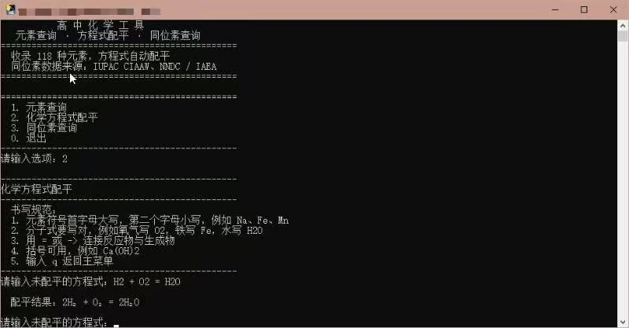
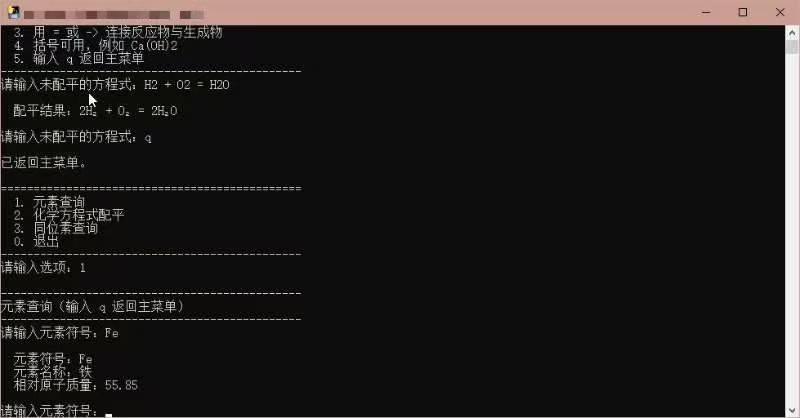

# 高中化学工具

一个纯本地的命令行小工具，**不联网、不装第三方库、双击即用**。



## 三个功能

**1. 元素查询** —— 输入元素符号（`Fe`、`Na`），显示中文名和相对原子质量，收录全部 118 种元素。

**2. 化学方程式配平** —— 输入未配平的方程式，自动配平并把数字转成下标。

```
输入：H2 + O2 = H2O
输出：2H₂ + O₂ = 2H₂O
```

支持括号（`Ca(OH)2`、`Al2(SO4)3`），`=` 或 `->` 连接两边。配平不出来时会明确说哪一项有问题，不会编答案。

**3. 同位素查询** —— 24 种常见元素的质量数、天然丰度、稳定性、半衰期、主要用途，每条数据单独标注把握度（高 / 中 / 不确定）。



## 使用方法

**方式一：直接跑 exe（Windows，免装 Python）**

到页面右侧的 Releases 下载 `化学工具.exe`，双击运行。

> 注：exe 由 PyInstaller 打包、没有数字签名，部分杀毒软件可能误报。这是打包工具的常见现象。

**方式二：用 Python 跑源码**

```bash
python 化学工具.py
```

Python 3.6 以上即可，只用标准库。Windows / macOS / Linux 都能跑。更详细的操作说明见 [使用说明.md](使用说明.md)。

## 操作

菜单里输入数字选功能，输入 `q` 返回上一层，`0` 退出。

## 数据来源

- 相对原子质量、同位素丰度：IUPAC CIAAW
- 半衰期、衰变方式：NNDC（美国国家核数据中心）、IAEA
- 元素中文名：按国家标准

同位素数据里把握不足的都标了「中」或「不确定」，请以权威数据库为准。

## 许可

个人学习使用，自由使用和修改。
